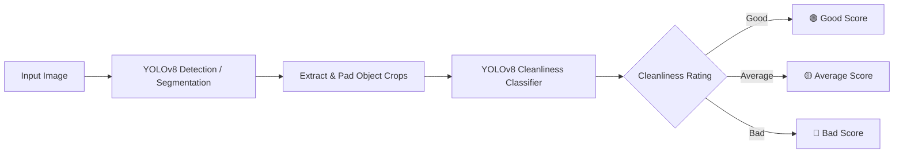

# Sanitation AI 🧼🤖

**Sanitation AI** is an intelligent computer vision system for automated cleanliness inspection and sanitation monitoring. It combines **YOLOv8 instance segmentation/detection** with a dedicated **YOLO cleanliness classifier** to detect sanitation objects (toilets, washbasins, dustbins, aisles) and evaluate their hygienic condition in real time.

---

## 📌 Features

- **Two-Stage Vision Pipeline**:
  1. **Object Detection / Segmentation**: Detects and localizes 13 sanitation and facility classes.
  2. **Cleanliness Classification**: Crops detected objects and classifies cleanliness level into **`Good`**, **`Average`**, or **`Bad`**.
- **Interactive Web Dashboard (Flask)**:
  - 🔍 **Single Inspection**: Upload any image or choose from test samples to get real-time visual bounding boxes, cleanliness ratings, and confidence percentages.
  - 📊 **Batch Test Suite**: Run bulk evaluations on test image directories.
  - ⚙️ **Configurable Parameters**: Adjust detection threshold, padding, and minimum crop dimensions.
- **Trained Pre-Loaded Weights**: Includes pre-trained weights for segmentation (`runs/segment/weights/segment.pt`) and cleanliness classification (`runs/classify/weights/classify.pt`).
- **Batch Processing Scripts**: CLI scripts for directory validation, JSON/LabelMe conversion, and data segregation.

---

## 🏷️ Detected Classes

The model detects 13 key sanitation areas:
1. `commode_cover`
2. `commode_seat`
3. `commode_floor`
4. `commode_wall`
5. `washbasin`
6. `washbasin_wall`
7. `washbasin_floor`
8. `washbasin_soap_holder`
9. `washbasin_tap`
10. `dustbin`
11. `dustbin_wall`
12. `dustbin_floor`
13. `aisle`

---

## 🚀 Quick Start

### 1. Prerequisites & Installation

Clone the repository and install the dependencies:

```bash
git clone https://github.com/Ritesh189646/sanitation-AI.git
cd sanitation-AI
pip install -r requirements.txt
```

### 2. Launch the Web UI

Launch the interactive web dashboard (will automatically open in your default browser at `http://127.0.0.1:5000`):

```bash
python run_ui.py
```

Or start the Flask server directly:

```bash
python app.py
```

### 3. Run CLI Batch Inference

Run cleanliness prediction on sample test images from `test_images/` saving annotated outputs to `results2/`:

```bash
python predict_cleanliness.py
```

---

## 📂 Project Structure

```text
sanitation-AI/
├── app.py                         # Flask web backend & API endpoints
├── run_ui.py                      # One-click launcher (Flask + Browser)
├── predict_cleanliness.py         # Batch prediction script
├── cleanliness_check.py           # Cleanliness evaluation script
├── data.yaml                      # YOLO dataset class configuration
├── requirements.txt               # Python package dependencies
├── templates/
│   └── index.html                 # Modern dark-theme UI dashboard
├── static/
│   ├── css/style.css              # Custom styling
│   └── js/main.js                 # Frontend interactions & API handlers
├── test_images/                   # Sample test images for inspection
└── runs/                          # Trained models and evaluation metrics
    ├── segment/weights/segment.pt # YOLOv8 segmentation model
    └── classify/weights/classify.pt# YOLOv8 classification model
```

---

## 🧠 System Architecture



---

## 📄 License

This project is licensed under the MIT License.
